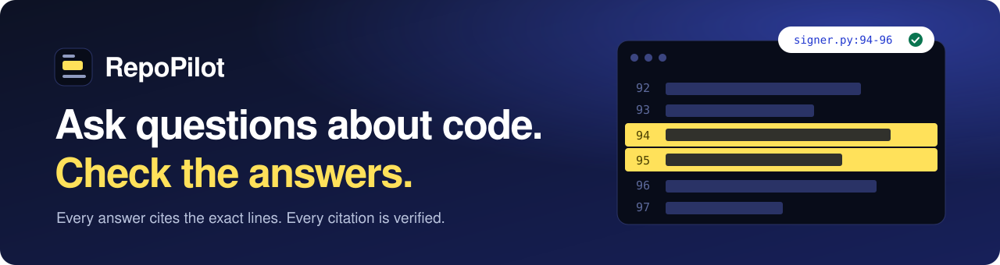
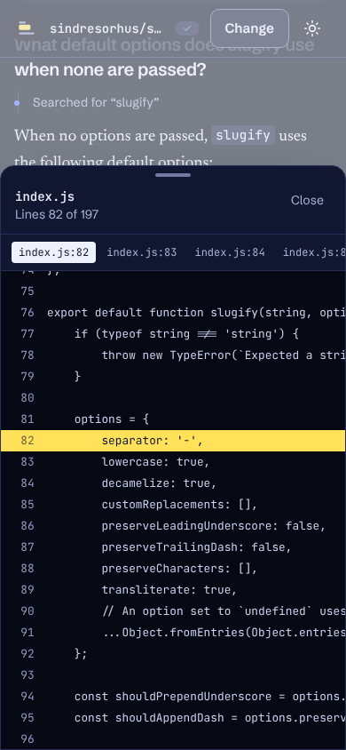
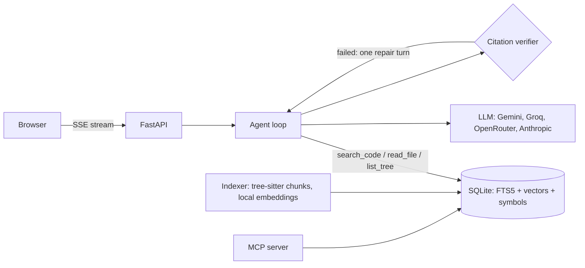

<p align="center">
  
</p>

<p align="center">
  <a href="https://repopilot-wekf.onrender.com"></a>
</p>

<p align="center">
  <a href="https://github.com/KevinGeorge100/repopilot/actions/workflows/ci.yml"></a>
  
  
  
  
  <a href="LICENSE"></a>
</p>

## In 30 seconds

> **The problem.** Opening someone else's code is confusing, and AI assistants that explain it ask you to *trust* them.
>
> **What I built.** RepoPilot lets you paste any public GitHub link and ask questions in plain English. Every answer
> ends in tags like `signer.py:94-96`. Click one and the exact lines light up in the real source. Before an answer is
> shown, RepoPilot checks that each tag is real: the file exists, the lines exist, and the AI actually read them.
>
> **Why it's different.** It doesn't just claim to be accurate. It measures itself: **35 of 38** test questions
> answered correctly, scored by code rather than by another AI, with every failure written up.

<table>
  <tr>
    <td width="68%"></td>
    <td width="32%"></td>
  </tr>
  <tr>
    <td align="center"><sub>Laptop: repo, conversation and evidence side by side</sub></td>
    <td align="center"><sub>Phone: evidence slides up as a sheet</sub></td>
  </tr>
</table>

## What it does

| | |
|---|---|
| **Cited answers** | A small agent searches and reads the code, then answers. A failed citation check gets one repair turn; anything still wrong is struck through and explained, never hidden. |
| **Any public repo** | Paste a link. It's ready to ask about in a few seconds while search sharpens in the background, and you can queue a question while you wait. |
| **Pull request review** | Reports bugs, security problems and risks in a public PR. Every finding must point at a line the PR actually added, or it is rejected. *(Command line, API and MCP; no web screen yet.)* |
| **MCP server** | Seven tools so an AI assistant such as Claude Code can search, read, ask about and review any public repo. |
| **Free to run** | Local embeddings, and Gemini, Groq, OpenRouter or Anthropic for the model. The hosted demo runs on free tiers. |

## Does it work? Measured, not claimed

38 questions over three repos pinned to exact commits (two Python, one JavaScript), including 6 where the right answer
is "this is not in the repo". Scoring is deterministic with no AI judge: every expected fact must be present, a
verified citation must overlap the real evidence lines, and no citation may be invalid or unread.

| On `gemini-3.5-flash-lite`, all 38 questions | Before | After (shipped code) |
|---|---|---|
| Answered correctly | 32 of 38 (84%) | **35 of 38 (92%)** |
| Questions that ended with no answer | 3 | **0** |
| Repeated searches | 19 | **2** |
| Tokens per question | 22.2k | **13.5k** (-39%) |
| Index time for a 2,015-chunk repo | 263 s | **71 s** |

<details>
<summary><b>The honest caveats (worth reading)</b></summary>

- The pass-rate change is 3 questions, so on its own it is suggestive. A second run on the final code reproduced the same
  three failures. The rows beneath it have clear causes visible in the traces.
- Four of the first baseline's nine failures turned out to be **my own scoring mistakes**. I fixed them and said so.
- I corrected an earlier claim of mine about embedding batch size after measuring it properly (batch 1 is 3x faster and
  uses a third of the memory, with identical vectors).
- The questions were written by the person who built the system, one run per variant, on one small model. It is
  evidence, not proof.

Full numbers, retrieval measurements and known failures: [evals/RESULTS.md](evals/RESULTS.md). Method: [evals/README.md](evals/README.md).
</details>

## What this project shows

Each row links to the evidence in the repo, so you can check rather than take my word for it.

| Skill | Where to look |
|---|---|
| **AI agents and tool use** | Tool-use loop with duplicate-call hints, a forced final answer and a citation repair turn: [`agent.py`](src/repopilot/agent.py), [`citations.py`](src/repopilot/citations.py) |
| **Search and retrieval** | Keyword + vector + symbol-name matching fused by reciprocal rank fusion in SQLite; measured without a model (hit@8 97-100%): [`store.py`](src/repopilot/store.py) |
| **Evaluation and honest measurement** | 38-question harness, deterministic scoring, confidence intervals, resumable runs, disclosed mistakes: [`evals/`](evals/) |
| **Backend engineering** | FastAPI with streaming (SSE), background indexing jobs, rate limits and daily caps: [`server.py`](src/repopilot/server.py), [`indexing.py`](src/repopilot/indexing.py) |
| **Security thinking** | Repo text treated as untrusted; read-only tools; found and fixed a symlink hole before opening the app to the public: [SECURITY.md](SECURITY.md), [DECISIONS #35](DECISIONS.md) |
| **Product and UX** | Plain-language landing page with a live demo, a waiting experience that lets you ask early, light and dark themes, phone and laptop layouts: [`web/`](web/) |
| **Accessibility** | Contrast of every colour pair checked in CI; automated axe scans found real issues that I fixed: [`web/DESIGN.md`](web/DESIGN.md) |
| **Design systems** | Tokens, type scale, components and a live style guide at `/styleguide/`: [`web/DESIGN.md`](web/DESIGN.md) |
| **Shipping and operations** | Docker image, Render deployment, CI on every PR, small squash-merged pull requests: [DEPLOY.md](DEPLOY.md), [CONTRIBUTING.md](CONTRIBUTING.md) |
| **Writing decisions down** | 37 numbered decisions with the evidence behind them, including the ones that changed: [DECISIONS.md](DECISIONS.md) |
| **Interoperability** | An MCP server so other AI tools can use it: [`mcp_server.py`](src/repopilot/mcp_server.py) |

> Built with [Claude Code](https://claude.com/claude-code) as the pair programmer. The reasoning and the evidence for each
> choice are in [DECISIONS.md](DECISIONS.md).

## Try it

**Live demo: <https://repopilot-wekf.onrender.com>**. It runs on Render's free plan, so the first visit after a quiet spell
waits tens of seconds for the service to wake. Questions you type are answered live, up to a daily cap. To host your own
copy, see [DEPLOY.md](DEPLOY.md).

**Locally** (no limits):

```bash
git clone https://github.com/KevinGeorge100/repopilot.git && cd repopilot
uv sync
export REPOPILOT_PROVIDER=gemini GEMINI_API_KEY=...     # free key: aistudio.google.com/api-keys
uv run repopilot serve                                   # API on :8000

cd web && npm install && npm run dev                     # UI on :3000
```

Command line: `uv run repopilot index <github-url>`, then `uv run repopilot ask <owner--repo> "question"`.

### Use it from Claude Code or Claude Desktop (MCP)

```bash
claude mcp add repopilot -- uv run --directory /path/to/repopilot repopilot mcp
```

Tools: `index_repo` (background, then poll `repo_status`), `search_code`, `read_file`, `list_tree`, `ask_repo`,
`review_pr`. The first four need no model key. Verified with the MCP SDK's own client over a real stdio process; not yet
tried in Claude Code or Claude Desktop themselves.

### Review a pull request

```bash
uv run repopilot review https://github.com/owner/repo/pull/123
```

Set `GITHUB_TOKEN` to raise GitHub's unauthenticated limit (60 requests per hour per IP).

## How it works



1. **Index.** Shallow-clone the repo and split source into functions and methods with tree-sitter (long classes become
   one chunk per method). Keyword and name search are ready immediately; local `bge-small` vectors are added in the
   background. Everything is one SQLite file. Search fuses keyword (BM25), vector similarity, and a match between query
   identifiers and the names a chunk defines.
2. **Ask.** The agent calls three read-only tools and streams each step. Repeated searches get a hint instead of more
   results, and the last step forces a best-effort answer.
3. **Verify.** Every citation is checked against the repo and against what the agent read. An honest "not in this repo"
   answer is accepted without a citation, because there is nothing to cite.

## Engineering

- **190 automated tests** and CI on every pull request (lint, tests, web type-check, colour-contrast check and a
  production build), plus a secret-scanning check from GitHub. Changes land through small, squash-merged pull requests;
  see [CONTRIBUTING.md](CONTRIBUTING.md).
- **Security posture.** Repo text is untrusted data (in testing, an instruction planted in a diff telling the reviewer to
  approve everything was ignored); tools are read-only; GitHub URLs and repo names are strictly validated; symlinks are
  never followed; the container runs unprivileged; rate limits, size limits, step and token budgets, and global daily caps
  protect a public deployment. See [SECURITY.md](SECURITY.md).

## Limits

- Code snippets are sent to the model provider to write live answers (the free Gemini tier may use them to improve
  Google's products). Do not point this at private code.
- The hosted app trims big repos (1,500 pieces of code), keeps only the last few repos people added, and limits how many
  new repos it takes per day, so it fits a free 512 MB instance. Run it locally for no limits.
- Evaluation questions were written by the author, one run per variant, on one small model.
- No usability study with real people and no screen-reader pass yet; automated accessibility scans are clean.
- The PR-review feature has no screen in the web UI yet; it is available through the CLI, the API and MCP.

## License

MIT. See [LICENSE](LICENSE). Built by [KevinGeorge100](https://github.com/KevinGeorge100).
