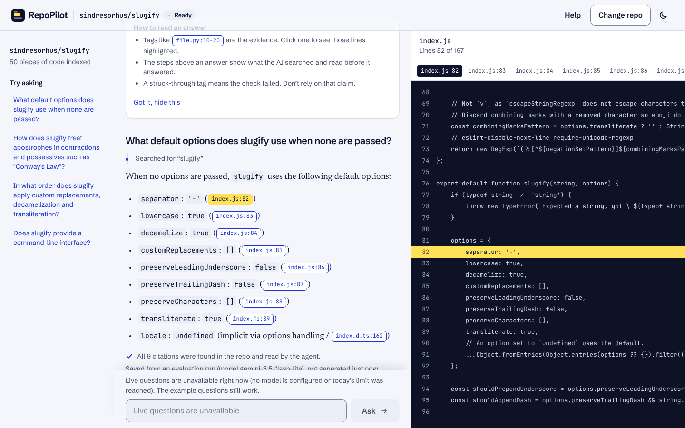
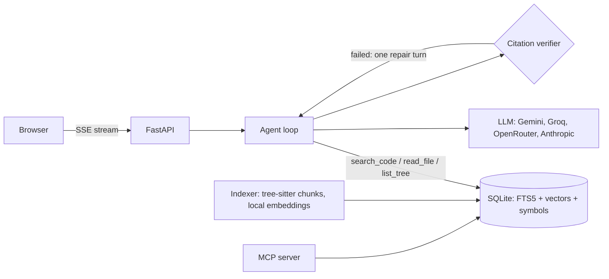

# RepoPilot

[](https://github.com/KevinGeorge100/repopilot/actions/workflows/ci.yml)

**Ask a public GitHub repo anything. Every answer cites the exact lines of code behind it, and RepoPilot checks that
each citation is real and that the agent actually read it.**



Most code assistants give you an answer and ask you to trust it. RepoPilot gives you the answer and the evidence:
click a citation and the lines it points at are highlighted in the real source. Citations that do not check out are
struck through and explained, never silently shown.

## What it does

- **Cited answers.** A small tool-use agent searches and reads the code, then answers. Every `path:start-end`
  citation is verified three ways: the file exists, the range is inside it, and the agent really retrieved those lines.
  A failed check gets one repair turn; anything still wrong is struck through in the UI.
- **Pull request review.** Reports bugs, security problems and risks in a public PR. Every finding must point at a line
  the PR actually added, or it is rejected.
- **MCP server.** Seven tools so an assistant such as Claude Code can search, read, ask about and review any public repo.
- **Runs on free tiers.** Local embeddings; Gemini, Groq, OpenRouter or Anthropic for the model.

## Try it

**Live demo: <https://repopilot-wekf.onrender.com>**. It serves three pre-indexed repos. The example questions are real
answers saved from an evaluation run and are labelled as such; anything you type is answered live by the model, up to a
daily cap. It runs on Render's free plan, so the first visit after a quiet spell waits tens of seconds for the service
to wake. To host your own copy, see [DEPLOY.md](DEPLOY.md).

**Locally** (any public repo):

```bash
git clone https://github.com/KevinGeorge100/repopilot.git && cd repopilot
uv sync
export REPOPILOT_PROVIDER=gemini GEMINI_API_KEY=...     # free key: aistudio.google.com/api-keys
uv run repopilot serve                                   # API on :8000

cd web && npm install && npm run dev                     # UI on :3000
```

Command line: `uv run repopilot index <github-url>`, then `uv run repopilot ask <owner--repo> "question"`.

## How it works



1. **Index.** Shallow-clone the repo and split source into functions and methods with tree-sitter (long classes become
   one chunk per method). Embed locally with `bge-small` and store everything in one SQLite file. Search fuses keyword
   (BM25), vector similarity, and a match between query identifiers and the names a chunk defines.
2. **Ask.** The agent calls three read-only tools and streams each step. Repeated searches get a hint instead of more
   results, and the last step forces a best-effort answer.
3. **Verify.** Every citation is checked against the repo and against what the agent read. An honest "not in this repo"
   answer is accepted without a citation, because there is nothing to cite.

## Does it work? Measured, not claimed

38 questions over three repos pinned to exact commits (two Python, one JavaScript), including 6 where the right
answer is "this is not in the repo". Scoring is deterministic, with no AI judge: every expected fact must be present, a
verified citation must overlap the real evidence lines, and no citation may be invalid or unread.

| On `gemini-3.5-flash-lite`, all 38 questions | before | after (shipped code) |
|---|---|---|
| Passed | 32/38 (84%) | **35/38 (92%)** |
| Questions that ended with no answer | 3 | **0** |
| Repeated searches | 19 | **2** |
| Tokens per question | 22.2k | **13.5k** |
| Index time for click (2,015 chunks) | 263s | **71s** |

What I would want a reviewer to know: the pass-rate change is only 3 questions, so on its own it is suggestive (a second
run on the final code reproduced the same three failures), while the rows beneath it have clear causes in the traces.
Four of the first baseline's nine failures turned out to be **my own scoring mistakes**, which I fixed and disclosed. I
also corrected an earlier claim of mine about embedding batch size after measuring it properly (batch 1 is 3x faster and
uses a third of the memory, with identical vectors). The full numbers, retrieval
measurements, known failures and the limits of the evidence are in [evals/RESULTS.md](evals/RESULTS.md); the method is in
[evals/README.md](evals/README.md).

## Engineering

- **181 automated tests** and CI on every pull request (lint, tests, web type-check and production build), plus a
  secret-scanning check from GitHub.
  Changes land through small, squash-merged pull requests; see [CONTRIBUTING.md](CONTRIBUTING.md).
- **Decisions are written down** with the evidence behind them, including the ones that changed:
  [DECISIONS.md](DECISIONS.md).
- **Security posture.** Repo text is treated as untrusted data (in testing, an instruction planted in a diff telling the
  reviewer to approve everything was ignored); tools are read-only; GitHub URLs and repo names are strictly validated;
  the container is set up to run unprivileged; rate limits, step and token budgets, and a global daily cap on live
  questions protect a public deployment. See [SECURITY.md](SECURITY.md).

### Use it from Claude Code or Claude Desktop (MCP)

```bash
claude mcp add repopilot -- uv run --directory /path/to/repopilot repopilot mcp
```

Tools: `index_repo` (background, then poll `repo_status`), `search_code`, `read_file`, `list_tree`, `ask_repo`,
`review_pr`. The first four need no LLM key. Verified with the MCP SDK's own client over a real stdio process; not yet
tried in Claude Code or Claude Desktop themselves.

### Review a pull request

```bash
uv run repopilot review https://github.com/owner/repo/pull/123
```

Set `GITHUB_TOKEN` to raise GitHub's unauthenticated limit (60 requests per hour per IP).

## Limits

- Code snippets are sent to the model provider to write live answers (the free Gemini tier may use them to improve
  Google's products). Do not point this at private code.
- The hosted demo serves a fixed set of repos so it fits a 512 MB free instance; indexing any repo works locally.
- Evaluation questions were written by the author, one run per variant, on one small model. It is evidence, not proof.
- The PR-review feature has no screen in the web UI yet; it is available through the CLI, the API and MCP.

## License

MIT. See [LICENSE](LICENSE).
